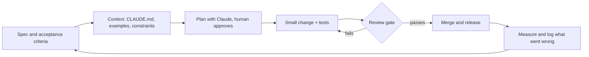

# AI-native delivery playbook

How I ship software with Claude Code as a core part of the team, written down so it can be repeated, reviewed and taught.

The short version: AI makes the typing cheap, so the scarce things become clear specs, good context, small reviewable changes and real tests. This playbook is about those.

## The loop

## Chapters

1. [Spec first](01-spec-first.md): why the spec is now the most valuable artefact in the repo
2. [Context is the product](02-context.md): CLAUDE.md, examples and constraints that keep output on track
3. [The working loop](03-working-loop.md): plan, small diffs, tests, repeat
4. [Review gates](04-review-gates.md): what a human always checks, and what can be automated
5. [Evaluating AI features](05-evals.md): when the thing you ship is itself an LLM feature
6. [Cost, risk and team adoption](06-cost-risk-adoption.md): for leads and managers rolling this out

## Templates

- [CLAUDE.md starter](templates/CLAUDE.md.example)
- [Task brief](templates/task-brief.md)
- [Review checklist](templates/review-checklist.md)

## Who this is for

- **Developers** who want more out of AI tools than autocomplete
- **Product owners** who now write specs that a model reads as closely as an engineer does
- **Engineering and AI leads** deciding how a team should work with agents safely

## Principles

- The human owns the outcome. The model is a fast, tireless colleague, not an authority
- Small diffs beat big ones. If a change is too big to review properly, it is too big to merge
- Tests are the contract. Code a model wrote and no test exercises is unverified
- Never paste secrets, customer data or payment details into a prompt
- Write down what went wrong. The failure log is the most useful file in this repo

## Licence

MIT. See [LICENSE](LICENSE).

---

Barry Gildea · Technical Product Owner and AI-native developer · [github.com/bgildea](https://github.com/bgildea)
